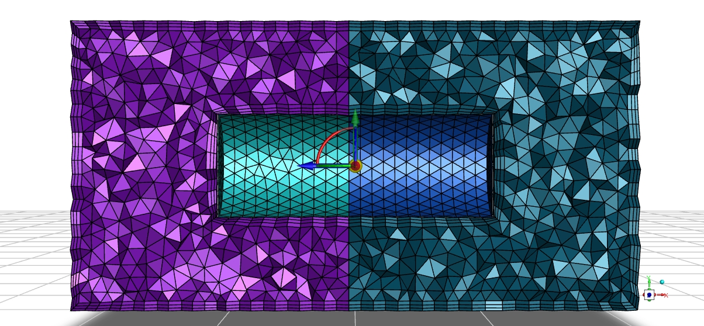
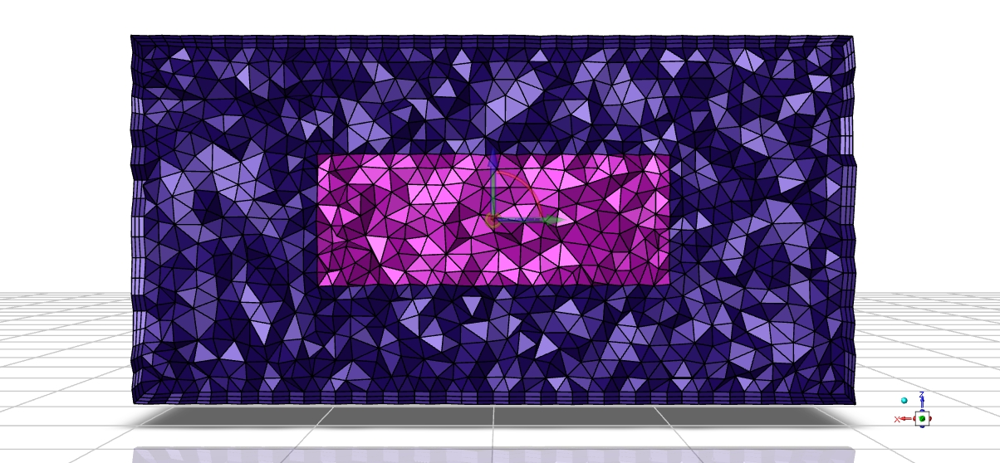
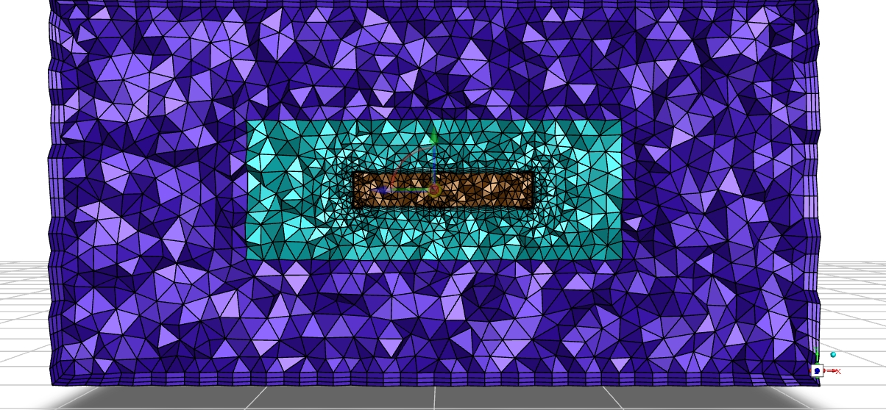
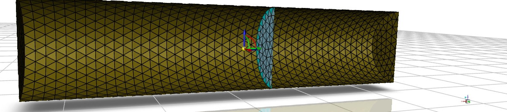
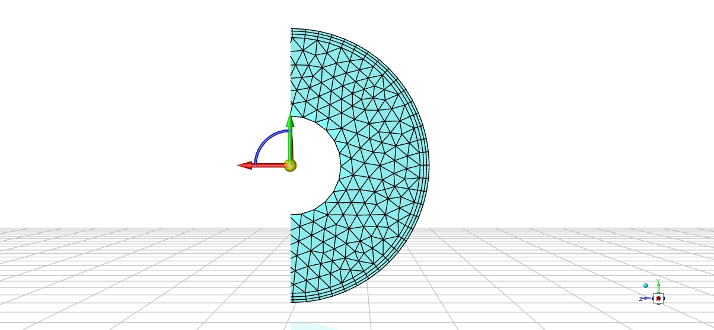
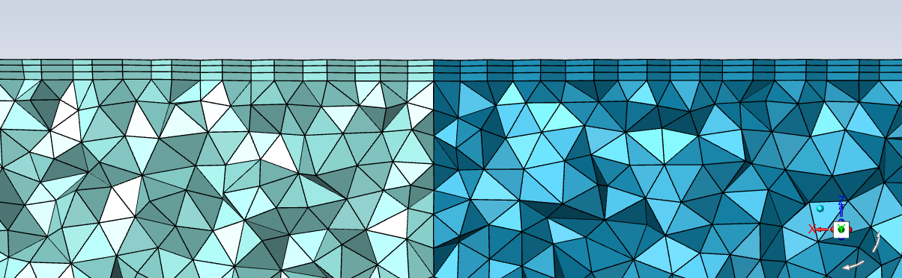

# Fluent Meshing 内部面（internal）网格生成流程

|  |  |  |
|:---:|:---:|:---:|
|  |  |  |
| **图 1(a)　内外物面与中间内部面** | **图 1(b)　外部物面与内部闭合面** | **图 1(c)　多层内部面** |

> **案例说明**
>
> **图 1(a)：** 内、外两个圆柱面都是物面，中间圆环柱面为内部面。
>
> **图 1(b)：** 外部圆柱面是物面，内部圆柱面是内部面。
>
> **图 1(c)：** 最外层与最内层是物面，中间层是内部面。

> **说明：** 本文只讨论网格生成过程。输入假定为已经完成三角离散、区域标记和相交边共享的表面网格。

## Fluent Meshing 生长流程

Fluent 中的内部面 `internal` 是位于体网格内部、允许流体穿过、但需要在最终网格中显式保留的网格面。内部面本身不推出附面层，其两侧体单元应共享同一套面节点、边和面单元。

从网格生成角度看，内部面同时具有两种作用。

**一是区域划分：** 把待填充空间分成若干可以分别生成体网格的网格区域。

**二是拓扑约束：** 作为四面体网格生成时不可穿越的约束面。体网格生成完成后，内部面的每一个三角形或四边形都应与两侧各一个体单元相邻。

这里的区域划分只服务于网格生成，用于组织各封闭区域的附面层和体网格填充任务，并不表示求解阶段必须形成彼此独立的 Cell Zone。网格生成完成后，内部面两侧仍可保持为连通的流体域。

当内部面与物面相接时，附面层总体沿物面法向推出；位于物面与内部面交线上的节点则受到内部面的切向约束。随着附面层逐层生长，内部面上会产生新的节点、边和四边形条带，原内部面三角网格需要随之进行局部重构。重构完成后，再在附面层外表面、重构后的内部面及其他边界面形成的新封闭包络中填充远场四面体网格。

整个过程可以概括为：

```text
带区域标记的表面网格
    → 按内部面划分网格区域
    → 固定内部面共享拓扑
    → 从物面生成棱柱附面层
    → 沿内部面推进交线节点
    → 重构内部面网格
    → 填充远场四面体网格
    → 拼合各区域并检查内部面双侧邻接
```

### Step 1：计算域的分割

对于内部面的处理，首先要根据输入表面网格中的面区标记和邻接关系，确定内部面两侧分别属于哪个网格区域。这里的“分割”是体网格生成前的区域划分。

在网格数据结构中，可为每个内部面建立两个方向相反的半面：一个半面归属于左侧区域，另一个半面归属于右侧区域。两个半面引用同一套节点和面连接，只是法向方向相反。这样可以对各区域分别生成体网格，同时保证最终拼合时内部面完全共形。

对于图 1(a)，内部圆环柱面两侧形成**两个待填充区域**。两个区域分别由**物面**、**端面**和**内部面**的一侧组成封闭网格包络。外侧区域和内侧区域可以分别生成附面层和四面体网格。

对于图 1(b)，闭合内部圆柱面将网格空间分成**内部区域**和**外部环形区域**。内部面上的每个三角形分别作为两个区域的边界面参与体网格生成。两个区域生成完成后，在内部面处共享同一套面网格。

对于图 1(c)，多层内部面会形成多个嵌套网格区域。算法需要记录每张内部面的左右区域编号，不能只根据面的法向或空间位置临时判断，否则在多层嵌套情况下容易发生区域归属错误。

#### 失败案例：中间面未形成独立网格区域

<div align="center">
  
</div>

<p align="center"><b>图 2　中间内部面未形成双侧区域</b></p>

该案例是在一个已经形成单一封闭区域的圆柱表面网格中插入一张中间圆面。中间面虽然位于体域内部，也具有三角形网格，但它没有真正把原网格区域分成两个封闭的待填充区域。

从体网格生成角度看，这张中间面只具有空间位置和表面单元，没有建立完整的双侧区域邻接。其边界没有参与两个封闭网格包络，中间面两侧也没有明确的区域编号。因此，体网格生成器无法判断该面是需要恢复的内部面，还是位于体域中的冗余悬空面。

在这种情况下，Fluent Meshing 在区域识别时将该面删除。

因此，对于存在内部面的情况，第一步要做的工作是区域划分。根据内部面识别不同的待填充区域，并在各区域所属的物面上分别生成附面层；内部面只作为区域边界和共享拓扑，不主动生长附面层。

### Step 2：共享面共享拓扑的生成

对于内部面两侧的不同网格区域，同一张内部面不能分别独立生成表面网格。两侧独立划分即使节点坐标完全重合，也可能得到不同的节点数量、边连接和三角剖分方式，最终只能形成非共形接口。

共形内部面的正确处理方式是只生成一次内部面网格，再由两侧区域共同引用。内部面只保留一个网格实体，两侧计算域以相反方向引用该实体，并分别建立相应的体单元邻接关系。

### Step 3：附面层处的推出与 internal 面的重构

当物面与内部面相接时，物面上的棱柱附面层总体沿物面法向生长。内部面自身不推出附面层，但内部面与物面的交线节点属于附面层前缘，因此这些节点的生长方向需要限制在内部面的切平面内，使其在推进过程中始终位于内部面上。

对于普通物面节点，生长方向可由周围物面三角形的法向综合计算并进行平滑。对于位于物面与内部面交线上的节点，需要去除生长方向中垂直于内部面的分量，仅保留内部面切向分量，使附面层在保持物面法向生长趋势的同时不穿出内部面。

附面层沿内部面推进后，原交线与新交线之间形成四边形条带。每个四边形由原层交线边、新层交线边和两条节点生长边组成。该四边形既是棱柱单元的侧面，也是新的内部面网格的一部分。

因此，需要对内部面执行局部重构。首先保存原内部面的边界环、特征边和三角形邻接关系，再提取新生成的四边形条带边界并将其作为不可修改的边界边，最后对四边形条带之外的空缺区域重新生成三角形。

内部面剩余区域可采用约束三角化方法重新填充。重构过程中，四边形条带、内部面边界、孔洞边界和特征边必须固定。

<div align="center">
  
  
</div>

<p align="center"><b>图 3　附面层生成后 internal 面的重构结果</b></p>

### Step 4：新外围包络内的远场体网格生成

**新包络的形成。** 附面层生成和内部面重构完成后，原有的远场填充边界会被一套新的表面网格取代。物面一侧不再直接作为四面体填充边界，而是由附面层最外层的三角形表面代替；在附面层与内部面相接的位置，新生成的四边形侧面成为内部面的一部分；内部面其余区域则由重构后的三角形网格组成。这些表面与其他未生成附面层的边界表面共同形成新的封闭包络，远场四面体网格将在该包络内部生成。

**远场网格填充。** 生成远场体网格时，首先需要汇总新包络上的全部节点、边和面，并保持各表面的区域标识和拓扑连接关系。附面层最外层表面、内部面上的四边形侧带以及重构后的内部面三角形都属于不可被四面体穿越的约束面。体网格生成器根据局部网格尺寸在远场区域布置内部节点，并生成初始四面体网格，随后对缺失的约束边和约束面进行恢复，使附面层外表面和内部面完整地出现在最终四面体网格中。

**区域拼合。** 各网格区域分别生成体网格后，需要在内部面处进行统一拼合。拼合过程不应再次合并两套位置相近的表面网格，而应直接使用前面已经建立的共享节点和共享面。拼合完成后，重点检查内部面两侧的节点、边和面是否完全一致，是否存在穿越内部面的体单元，以及网格中是否存在负体积、重复面、自由边和孤立单元。只有内部面保持双侧邻接、附面层外表面与远场四面体完全共形，新的体网格包络才算填充完成。

**多面体转换。** 如果后续需要把四面体网格转换为多面体网格，单元聚合过程也不能跨越内部面、物面或棱柱层外边界。内部面应始终作为不同单元之间的保留面存在。转换后的内部面虽然可能由多个三角形合并成较大的多边形，但其 Face Zone、左右区域关系和双侧体单元邻接应与转换前保持一致。
